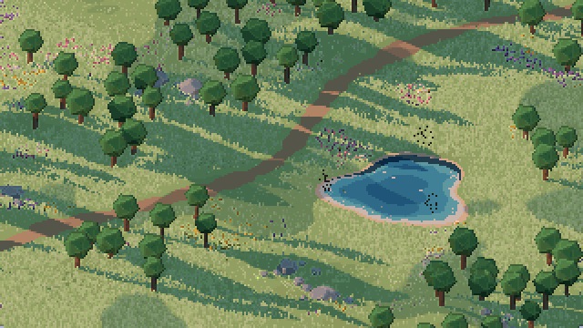

# pixel3d

A pixel-art 3D scene built with [three.js](https://threejs.org/) + [Vite]: windswept grass, wildflowers, butterflies, dragonflies, fireflies and gnats, a pond, a dirt path, trees, rocks, clouds and a day–night cycle, rendered through `RenderPixelatedPass`.



## Running

```bash
npm install
npm run dev        # http://127.0.0.1:5173/
npm run build      # build into dist/
npm test           # headless behaviour tests (node --test)
npm run preview    # serve the build
```

## Layout

| File | Contents |
|---|---|
| `src/main.js` | Renderer, orthographic camera (`VIEW_HEIGHT`, `PIXEL_SIZE`), post-processing, render loop |
| `src/world.js` | Ground, pond, dirt path, trees, rocks; map `SIZE`; shared noise/PRNG |
| `src/grass.js` | Instanced grass + wind shader |
| `src/flowers.js` | Instanced wildflower patches, swaying with the grass |
| `src/insects.js` | Builds every insect species; shared flight helpers (steering, obstacle avoidance) |
| `src/butterflies.js` | Butterflies: flower to flower, feeding, basking on rocks, roosting at night |
| `src/dragonflies.js` | Dragonflies: pond-rim territories, darts and hovers, perching, settling at night |
| `src/fireflies.js` | Fireflies: dusk-to-midnight swarms, fading J flashes, females answering males |
| `src/gnats.js` | Gnats: dusk and dawn swarms over the pond rim, scattered by hunting dragonflies |
| `src/motion.js` | Shared motion helpers: per-insect random streams, easing, turning spring, weighted choice |
| `src/frame-limiter.js` | Frame-rate cap behind the fps selector |
| `src/settings.js` | Viewer settings, each remembered in its own localStorage key |
| `src/clock.js` | Park post clock beside the path, showing the viewer's local time |
| `src/sun.js` | Sunrise/sunset for the viewer's date, place guessed from the time zone |
| `src/sky.js` | Sun light, day–night cycle (clock hour ↔ sky phase), ground fog, clouds and cloud shadows |
| `src/bench.js` | Perf baseline behind `?bench`: CPU stage, draw-call and GPU timings per hour |

## Controls

Bottom-left: a time-of-day slider (jumps the sky clock) and a ⚙ button opening the settings, each remembered:

| Setting | Options |
|---|---|
| Pixel size | 2 / 3 / 4 device px per art pixel |
| FPS cap | Native / 60 / 30 / 20 / 15 (default 15) |
| Time | Manual (the slider) / Clock (the sky follows the local time, sunrise and sunset guessed from the time zone) |
| Fog | Off / Auto (rolls in at dusk, burns off after sunrise, thicker in winter) / Always |
| Hide HUD | Hides the slider and dims the ⚙ button |
| Show clock | The post clock beside the path |

`?wallpaper` hides the HUD, follows the local clock and caps at 15 fps for that page only, leaving the saved settings alone.

## Conventions

Branches, commits, versioning and releases: see [CONTRIBUTING.md](CONTRIBUTING.md).

[Vite]: https://vite.dev/
